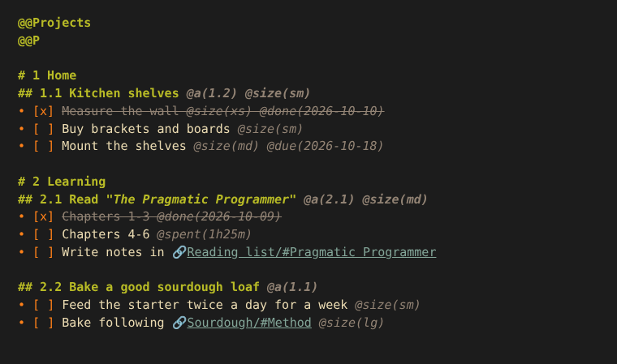
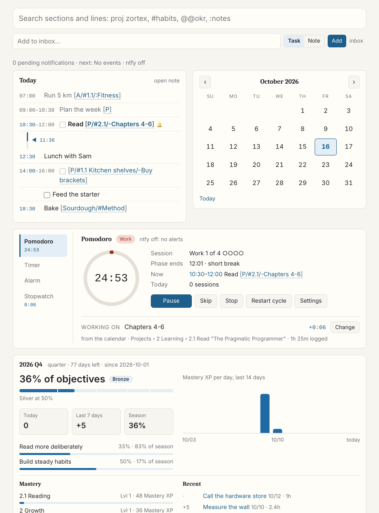

# zortex.nvim

A plain-text second brain for Neovim. Notes are `.zortex` files (a markdown
dialect) that link to each other by structure: `[Sourdough/#Method]`,
`[P/#1.1 Kitchen shelves]`. Projects, areas, objectives and a calendar are
notes too, so tasks, plans and knowledge live in one folder you can sync.
An optional server shows it all in the browser, with a calendar, a pomodoro
and notifications on your phone.

<p align="center">
  
  
</p>

- **Structural search** over every note: `2 4` finds `1 › 2 › 3 › 4`.
  Hundreds of notes and tens of thousands of lines stay instant.
- **Links** that name structure, not ids: follow, preview, complete while
  typing, backlinks, broken links.
- **Projects, areas and OKRs** (PARA plus objectives and key results) with
  progress, due dates and a weekly review; a **day planner** that fills the
  calendar from them.
- **XP and seasons** read off the tasks you complete.
- **`zortex serve`** (optional, one Go binary): your notes on the web, the
  calendar, ntfy notifications, a pomodoro shared with Neovim, timers and
  time tracking, light editing from your phone.

## Quickstart

Needs Neovim 0.10 or newer. With [lazy.nvim](https://github.com/folke/lazy.nvim):

```lua
{
  "t-wilkinson/zortex.nvim",
  dependencies = {
    "nvim-telescope/telescope.nvim", -- optional: search and project pickers
    "hrsh7th/nvim-cmp",              -- optional: link completion
  },
  config = function()
    require("zortex").setup({ notes_dir = "~/zortex" })
  end,
}
```

Then, in five minutes:

1. **Start Neovim.** `~/zortex` is created with the key notes: `structure`,
   `projects`, `areas`, `okr`, `calendar` and `inbox`, from short templates
   that link to each other. (In a folder that already has notes nothing is
   written; `:ZortexInit` adds what's missing.)
2. **Open the structure note**, the map of everything: `<leader>zfs`. Notes
   open folded to their headings: `zR` opens every fold, `zo` the one under
   the cursor (`features = { folding = { level = 99 } }` starts unfolded).
   Put the cursor on `[Projects]` and follow it with `<leader>zgx`.
3. **Add a task** under `# 1 Example project`: `- [ ] Read the docs @size(sm)`.
   Toggle it with `<leader>zT`: it becomes `[x]` with `@done(today)` (and
   an `@id`, which keeps links and the web app pointing at it).
4. **Write a note**: `:e ~/zortex/z/bread.zortex`, first line `@@Bread`, then
   `# Method` and a few lines. Back in the structure note, type `[Bre`:
   completion offers `Bread`; `[Bread/#Method]` links to the heading.
5. **Search** with `<leader>zz` (telescope): type `bread meth` (words match the section
   path in order).
6. **Plan the day** with `<leader>zm`: today's calendar next to your tasks;
   `p` puts one on the day.

Next: the note format is in [doc/Syntax.md](doc/Syntax.md),
[doc/example](doc/example) is a small folder using most of it, and
`:checkhealth zortex` checks the setup. The server is optional; see
[doc/Server.md](doc/Server.md).

**Configuration.** Every option and its default is in
[`lua/zortex/config.lua`](lua/zortex/config.lua); `setup()` merges yours over
them. Commonly changed: `keymaps.prefix` (default `<leader>z`),
`ui.highlights` (colours follow your colorscheme; `preset = "rose-pine"` for
the author's palette), `ui.calendar.icons` (plain Unicode; a Nerd Font set
is in a comment there), `ui.planner.templates` (a new calendar day's lines)
and `xp` (how many hours each `@size` stands for, and what that is worth;
`:ZortexXPGuide` shows it).

## Notes

Every note is a `.zortex` file under `notes_dir` (subfolders included; `z/`
is the usual place for the library). A note starts with a header:

```
@@Projects          article name (the first @@ line)
@@P                 alias
@Me                 tag
@size(lg)           header attribute
```

The body has headings (`#` … `######`), bold headings (`**Next steps:**`),
labels (`Ideas:`), list items and tasks (`- [ ] task @size(sm)`,
`14:00 event`), attributes (`@p1`, `@due(2026-10-20)`, `@a(4.1)`), links
(`[P/#1.4 - zortex]`, `[A/#1.2/:Fitness]`, `[/#Local heading]`) and the
usual markdown blocks and inline markup. **[doc/Syntax.md](doc/Syntax.md)** is
the complete reference; a test checks its examples against the parser.

Special notes:

- **`projects.zortex`** (`@@Projects` / `@@P`): headings are projects and
  sub-projects; any note tagged `@P` is a project too. Link them as `[P/…]`.
- **`areas.zortex`** (`@@Areas` / `@@A`): headings and labels are areas;
  `@a(4.1)` on a project or objective links it to an area.
- **`okr.zortex`**: headings like `## 3M-2026-Q1 Title` are objectives; their
  `- KRn:` items are key results, and project links on a KR drive its
  progress.
- **`calendar.zortex`**: `YYYY-MM-DD:` labels with entries under them
  (`- [ ] task`, `14:00 event`, `- note`).
- Notes tagged `@Archive` (or named `z/archive.*`) are left out of links,
  projects and search ranking.

[doc/Projects.md](doc/Projects.md) has the full projects and areas reference.

## What it does

- **Structural search** (`<leader>zz`): words match a section's path in order
  (`2 4` finds `1 › 2 › 3 › 4`), results are breadcrumbs ranked by hierarchy,
  and what you open often ranks higher.
- **Links**: follow (`<leader>zgx`), preview in a float (`<leader>zK`, or on
  hover with `ui = { preview = { on_hover = true } }`), complete while typing,
  backlinks and broken links in the quickfix list. A persistent link index
  keeps this fast.
- **Highlighting and folding** for the whole format, with concealed markers.
- **Projects**: picker with progress, points, due dates, areas and key
  results; `@progress` written back on request.
- **Day planner** (`<leader>zm`): opens today's calendar day (created from
  your weekday/Saturday/Sunday template) next to ranked candidates: tasks on
  key results first (the further a key result is behind schedule, the
  higher), then work with only an area, then the rest; due dates and
  priority add on top. `p` adds an item (with a link to it) to the day and
  stays in the list; `i`/`o`/`O` put it on the current/next/previous line
  and let you type its time.
- **Reviews**: daily (`<leader>zW`, since the last one) and weekly
  (`<leader>zw`). Both open with your objectives and key results against the
  time passed, the XP earned and how much of it was on key results, and the
  time spent per task; then what you completed, what's overdue or due, and
  (weekly) stale and unscheduled projects, key results without projects,
  areas without an objective, broken links. Every line links to its source.
- **Calendar**: month/week views with project tasks and due dates, a digest
  panel, iCal import/export, notifications (synced to `zortex serve` and sent
  through ntfy; unchanged calendars aren't re-sent).
- **Pomodoro** (`<leader>zoo`): one clock shared with the web app's home page,
  with ntfy alerts and a different sound for work, breaks and a new cycle.
  Timers, alarms and a stopwatch are on the home page too, and their time
  goes to the task you're working on (`@spent(1h25m)`; by default the
  current calendar entry).
- **Planning and XP**: areas → objectives → key results → projects → tasks,
  a day planner that puts key-result work first, daily and weekly reviews,
  and XP that mirrors it (seasons for this quarter's objectives, Mastery for
  areas). See
  [doc/Planning.md](doc/Planning.md).
- **Export** (`:ZortexExport`): the notes and the whole model as JSON.

## Commands and keys

Every action is one entry in [`lua/zortex/actions.lua`](lua/zortex/actions.lua);
commands, keymaps and `require("zortex").actions` are generated from it, and
`:ZortexHelp` (`<leader>z?`) lists them with your prefixes. Change a key with
`keymaps.mappings`:

```lua
require("zortex").setup({
  keymaps = {
    prefix = "<leader>z",
    mappings = { task_toggle = "t", search_articles = false, review = { "w", "R" } },
  },
})
```

<!-- actions:start -->
**Find**

| Command | Keys | Action id | Does |
|---|---|---|---|
| `:ZortexSearch` | `<leader>zz` | `search` | Search sections and lines (structural search) |
| `:ZortexSearchArticles` | `<leader>zZ` | `search_articles` | Search article names |
| `:ZortexProjects` | `<leader>zp` | `projects` | Browse projects |
| `:ZortexTOC` | `<leader>zl` | `toc` | Table of contents of this note |
| `:ZortexTOCPopup` | `<leader>zL` | `toc_popup` | Table of contents in a popup |

**Links**

| Command | Keys | Action id | Does |
|---|---|---|---|
| `:ZortexLinkOpen` | `<leader>zgx` | `link_open` | Follow the link under the cursor |
| `:ZortexLinkPreview` | `<leader>zK` | `link_preview` | Preview the link target in a float |
| `:ZortexBacklinks` | `<leader>zb` | `backlinks` | Links into the section under the cursor (quickfix) |
| `:ZortexBrokenLinks` | `<leader>zB` | `broken_links` | Links that resolve nowhere (quickfix) |
| `:ZortexLinkIndexRebuild` |  | `link_index_rebuild` | Rebuild the link index from scratch |

**Structure**

| Command | Keys | Action id | Does |
|---|---|---|---|
| `:ZortexSectionNext` | `<leader>z]` | `section_next` | Next section at the same or higher level |
| `:ZortexSectionPrev` | `<leader>z[` | `section_prev` | Previous section at the same or higher level |
| `:ZortexSectionParent` | `<leader>z^` | `section_parent` | Parent section |
| `:ZortexFoldsUpdate` | `<leader>zr` | `folds_update` | Recompute folds |
| `:ZortexArchiveSection` | `<leader>za` | `archive_section` | Move the section under the cursor to the note's z/archive file |

**Tasks**

| Command | Keys | Action id | Does |
|---|---|---|---|
| `:ZortexTaskToggle` | `<leader>zT` | `task_toggle` | Toggle the task on this line (makes one if needed) |
| `:ZortexTaskComplete` | `<leader>ztc` | `task_complete` | Complete the task on this line |
| `:ZortexTaskUncomplete` | `<leader>ztu` | `task_uncomplete` | Reopen the task on this line |
| `:ZortexTaskConvert` | `<leader>ztt` | `task_convert` | Turn this line into a task |
| `:ZortexProjectProgress` | `<leader>zu` | `project_progress` | Write @progress(done/total) on project headings in this buffer |

**Plan**

| Command | Keys | Action id | Does |
|---|---|---|---|
| `:ZortexReview …` | `<leader>zw` | `review` | Review: week (default), day (since the last daily review), or a number of days |
| `:ZortexReviewDay` | `<leader>zW` | `review_day` | Daily review: completed, XP, time spent and the calendar since the last one |
| `:ZortexPlan …` | `<leader>zm` | `plan` | Plan a day: calendar day (from its template) plus ranked tasks, projects, KRs and areas to put on it |
| `:ZortexCalendar` | `<leader>zc` | `calendar` | Calendar view |
| `:ZortexCalendarDigest` | `<leader>zCc` | `calendar_digest` | Calendar view with the digest panel |
| `:ZortexDigest` | `<leader>zCd` | `digest` | Open the digest note |
| `:ZortexDigestUpdate` | `<leader>zCD` | `digest_update` | Regenerate the digest note |

**Pomodoro**

| Command | Keys | Action id | Does |
|---|---|---|---|
|  | `<leader>zoo` | `pomodoro_toggle` | Start, pause or resume the pomodoro |
|  | `<leader>zos` | `pomodoro_skip` | End the current pomodoro phase now |
|  | `<leader>zor` | `pomodoro_restart` | Begin a new pomodoro cycle |
|  | `<leader>zox` | `pomodoro_stop` | Stop the pomodoro |
|  | `<leader>zoi` | `pomodoro_status` | Show the pomodoro status |

**Calendar**

| Command | Keys | Action id | Does |
|---|---|---|---|
| `:ZortexNotificationsSync …` |  | `notifications_sync` | Sync calendar notifications (to the server if enabled); `force` resends unchanged |
| `:ZortexIcalImport` |  | `ical_import` | Import an iCal file or URL into the calendar |
| `:ZortexIcalExport` |  | `ical_export` | Export the calendar to an iCal file |

**Files**

| Command | Keys | Action id | Does |
|---|---|---|---|
| `:ZortexInit` |  | `init` | Create missing key notes (calendar, projects, areas, okr, structure, inbox) |
| `:ZortexOpenProjects` | `<leader>zfp` `<leader>zP` | `open_projects` | Open projects.zortex |
| `:ZortexOpenAreas` | `<leader>zfa` | `open_areas` | Open areas.zortex |
| `:ZortexOpenOKR` | `<leader>zfo` | `open_okr` | Open okr.zortex |
| `:ZortexOpenCalendar` | `<leader>zfc` | `open_calendar` | Open calendar.zortex |
| `:ZortexOpenStructure` | `<leader>zfs` | `open_structure` | Open structure.zortex |
| `:ZortexOpenInbox` | `<leader>zfi` | `open_inbox` | Open inbox.zortex |

**XP**

| Command | Keys | Action id | Does |
|---|---|---|---|
| `:ZortexSkillTree` | `<leader>zk` | `skill_tree` | Skill tree and season progress |
| `:ZortexXPStats` | `<leader>zxs` | `xp_stats` | XP statistics |
| `:ZortexXPAreas` | `<leader>zxa` | `xp_areas` | Top areas by XP |
| `:ZortexXPExplain` | `<leader>zxe` | `xp_explain` | How the project at the cursor earned its XP |
| `:ZortexXPGuide` | `<leader>zxg` | `xp_guide` | How XP is calibrated: hours per @size, Mastery, tiers |
| `:ZortexSeasonStatus` |  | `season_status` | Current season |
| `:ZortexSeasonStart …` |  | `season_start` | Start a season: [name] [end YYYY-MM-DD] [start YYYY-MM-DD] (prompts without args) |
| `:ZortexSeasonEnd` |  | `season_end` | End the current season |

**System**

| Command | Keys | Action id | Does |
|---|---|---|---|
| `:ZortexExport …` |  | `export` | Export notes and the model as JSON (default notes_dir/.z/export) |
| `:ZortexStatus` |  | `status` | Counts, state directory and event timings |
| `:ZortexLogs …` |  | `logs` | Recent log entries (optional count) |
| `:ZortexLogLevel …` |  | `log_level` | Set the log level |
| `:ZortexPerformance` |  | `performance` | Timer statistics |
| `:ZortexClearLogs` |  | `clear_logs` | Clear logs and timers |
| `:ZortexHelp` | `<leader>z?` | `help` | List commands and keys |
<!-- actions:end -->

Inside the calendar view: `h/j/k/l` days and weeks, `H/J/K/L` years and
months, `t` today, `a` add, `e` edit, `x` delete, `<CR>` entries, `v` toggle
month/week, `d` digest panel, `/` search, `gf` go to the file, `n` sync
notifications, `?` help, `q` close (`ui.calendar.keymaps`). In the review
buffer: `<CR>` jump to the source, `gx`/`K` follow or preview, `r` refresh,
`q` close.

## Lua API

`require("zortex")` is the API. Services load on first use:

```lua
local z = require("zortex")

z.actions.review()                        -- any action by id
z.run("review", { args = "14" })          -- with command-style arguments

z.query.search("1.4 zortex")              -- plain data, JSON-safe
z.query.note("projects.zortex")           -- header, outline, full syntax
z.query.tree("z")                         -- folders and notes
z.query.review({ days = 7 })

z.projects.all()                          -- Project entities
z.projects.resolve("[P/#1.4 - zortex]"):rollup()
z.okr.key_results({ open = true })
z.agenda.upcoming(7)
z.links.resolve_first("[A/#1 Personal Foundation]")
z.document.get(path).syntax               -- the parsed note
z.syntax.parse(lines, { inline = true })  -- the grammar itself
```

| name                                     | module            | what                                                                                                                                                |
| ---------------------------------------- | ----------------- | --------------------------------------------------------------------------------------------------------------------------------------------------- |
| `query`                                  | `zortex.query`    | plain-data views: `tree`, `note`, `search`, `resolve`, `backlinks`, `broken_links`, `projects`, `areas`, `objectives`, `agenda`, `review`, `export` |
| `projects`, `areas`, `okr`               | `services/*`      | entities: `all`, `get`, `at`, `resolve`, plus `query`/`tasks` (projects), `objectives`/`key_results` (OKR)                                          |
| `agenda`                                 | `services/agenda` | `day`, `range`, `upcoming`, `review`                                                                                                                |
| `calendar`                               | `stores/calendar` | entries by date, `add_entry`, `update_entry`, `delete_entry`                                                                                        |
| `tasks`                                  | `services/tasks`  | toggle/complete on the cursor line, `find_task_by_id`                                                                                               |
| `search`, `search_history`               | `services/*`      | structural search and its ranking history                                                                                                           |
| `digest`, `review`, `xp`                 |                   | digest note and email, review buffer, XP and seasons                                                                                                |
| `notes`, `document`, `syntax`, `item`    | `core/*`          | note index, parsed snapshots, grammar, list items                                                                                                   |
| `links`, `link_index`                    |                   | link resolution and the index of every link                                                                                                         |
| `workspace`, `state`, `events`, `config` |                   | line edits, `.z` state files, domain events, configuration                                                                                          |

## Documentation

- `:help zortex`: setup, commands and keys, every configuration default
- [doc/Syntax.md](doc/Syntax.md): the note format (lines, inline markup,
  attributes, links, special notes)
- [doc/example](doc/example): a small notes folder using most of the format
- [doc/Server.md](doc/Server.md): running `zortex serve` (Docker, NixOS, a
  proxy with a login, ntfy, connecting Neovim); [app/README.md](app/README.md)
  has every flag, page and endpoint
- [doc/Projects.md](doc/Projects.md): projects and areas reference
- [doc/Planning.md](doc/Planning.md): the plan (areas, OKRs, projects),
  the daily and weekly loop, and how XP, Mastery and seasons work
- [doc/Architecture.md](doc/Architecture.md): how the plugin is built (syntax,
  documents, links, entities, domain, state, query API, UI) and the rules
  modules share
- [CHANGELOG.md](CHANGELOG.md): releases, and what to change when upgrading
- [CONTRIBUTING.md](CONTRIBUTING.md): tests, generated files, releasing
- [doc/Wishlist.md](doc/Wishlist.md): planned features and ideas
- [doc/Philosophy.md](doc/Philosophy.md): why zortex is a personal wiki, not
  a Zettelkasten
- [contrib/ntfy](contrib/ntfy): desktop `ntfy subscribe` script with a sound
  per event
- Tests: `nvim --headless -u NONE -l tests/run.lua`; Go (parser, resolver,
  search, web app, notifications, pomodoro, clocks, time tracking):
  `go -C app test ./...`. CI runs both on every push.
